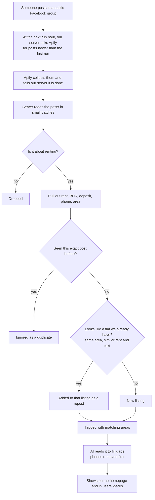

# App flows

What people do in Flat Hunt, step by step. Written for non-technical readers. Last updated 8 November 2026.

## Visitor flows

### 1. Browse all of Bangalore (no sign-in)

1. Open the app. It starts on **All Bangalore**: every rental post we have, newest first.
2. Each card shows rent, size (for example 2 BHK), type (flat, flatmate or PG), deposit, brokerage and when it was posted.
3. A post that appeared several times is shown once, with a "Posted 3×" note. Rent changes are kept.
4. The phone strip on each card reads "Sign in to call". The number is hidden.
5. Tap a card to see the full post and photos. Phone numbers, links and building names are blanked out.

### 2. Filter by area

1. Tap the area chip at the start of the filter row, or the area name at the top of the page.
2. Pick an area, such as Green Glen Layout, HSR Layout or Indiranagar. Or pick **All Bangalore** to see everything again.
3. The list now shows only posts that mention that area. The app recognises common spellings ("greenglen", "green glen layout").
4. Add more filters: BHK, rent range, flat / flatmate / PG, or "people looking" instead of "places offered".

## Signed-in user flows

### 3. Sign in

1. Tap **Sign in**, then **Continue with Google**.
2. Google asks you to confirm. Flat Hunt receives only your name, email and photo.
3. You come back signed in. If the admin has turned on "require approval", you see a "waiting for approval" message until an admin lets you in. Until then you can still browse like a visitor.

### 4. Choose your areas

1. Go to **Areas** and type the areas you are hunting in.
2. Flat Hunt finds matching posts it already has, then keeps matching new ones.

### 5. Review (swipe)

1. Open **Review**. You see one post at a time, from your areas only.
2. Swipe right (or tap Keep) to shortlist it. Swipe left (or tap Pass) to pass.
3. Undo appears for a few seconds if you change your mind.
4. If a shortlisted flat is posted again with new details, it is flagged as updated.

### 6. Shortlist

1. **Shortlist** holds the flats you kept, with full phone numbers and call/WhatsApp buttons.
2. Move each one through stages: To call → Called, waiting → Visit booked → Visited → Negotiating → Token paid.
3. Add your own notes, or correct the rent or other details. Your edits always win over what the app extracted.
4. **Passed** keeps the ones you rejected, in case you want one back.
5. Shortlisted flats are never deleted by the 30-day clean-up.

## Admin flows

### 7. Scraper schedule

1. Admin → **Scraper** shows the next run time and the last runs. For each run it shows posts fetched, new listings, reposts merged, posts dropped and the cost.
2. Choose **run hours** in India time (default 6 am, 9 am, then every 2 hours to 9 pm) or "every N hours".
3. Set **posts per group** (a safety cap, default 30), **max spend per run** (default $0.50) and how many days back a first run may look (1–5).
4. The page shows the Apify credit used this month. At 80% the scraper collects fewer posts; at 95% it pauses until the monthly reset.
5. **Run now** starts a scrape straight away.

### 8. Facebook groups

1. Admin → **Groups**: paste a Facebook group link and give it a name.
2. Facebook *Pages* (not groups) are accepted with a warning and skipped, because the scraper cannot read them.
3. Each group shows its spend, new listings per dollar, and a "Low value" flag. The flag marks groups that post a lot but rarely add new flats. Those are the first to drop when money is tight.
4. Groups that turn out to be private are listed so you can remove them.

### 9. Phone scans (private-group experiment)

1. On an Android phone, the admin runs a helper script while searching an area in Facebook Lite. The script reads the visible posts without touching anything.
2. Admin → **Phone scans**: upload the scan file.
3. The report says how many posts came from groups we do not scrape. That tells us whether private groups are worth more effort. This has not been run yet.

### 10. AI extraction

1. Admin → **AI** shows how many posts the AI read today, its confidence, any failures and the share of the free daily allowance used.
2. Turn the AI reader on or off, set its daily cap, retry failed posts.
3. When the AI thinks two listings are the same flat but is not sure, it suggests a merge. The admin chooses **Merge** or **Dismiss**.
4. Note: AI extraction currently fails in production with an "invalid JSON" error. The simple text rules still fill in the details.

### 11. Users and data

- Admin → **Users**: approve, block or promote people, and turn "require approval" on or off.
- Admin → **Data**: search all stored posts, delete bad ones, import pasted posts.

## Data flow: from a Facebook post to a listing

In words:
1. **Scrape.** At each run hour, the server asks Apify for posts newer than the last run, minus a 15-minute overlap. We pay per post, so we never ask for old ones.
2. **Ingest.** When Apify finishes, it calls our server. The server reads the posts in small batches, so it stays inside the free plan's limits. If it is cut off, it carries on where it stopped.
3. **Dedupe.** A post we have already seen is ignored. A repost of the same flat, even reworded, is merged into the existing listing. The same phone number alone does not merge two listings, because brokers post many different flats.
4. **Listing.** The result is one listing per flat, tagged with its areas. It shows on the homepage for everyone, and in the swipe deck of users who follow that area.
5. **Clean-up.** Each day, listings older than 30 days are removed, unless someone shortlisted them.
