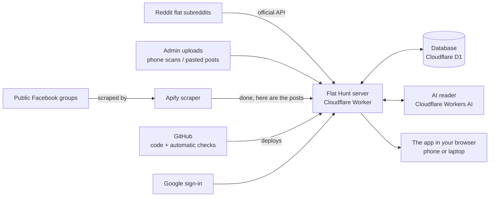

# How Flat Hunt works

A plain-language guide for anyone who wants to understand the app without reading code. Last updated 8 November 2026.

## The idea in one paragraph

Fresh flat listings in Bangalore appear first in Facebook groups, and the good ones go fast. Flat Hunt checks those groups for you several times a day. It reads each post, works out the rent, size, deposit and contact details, and merges reposts of the same flat. Then it shows every post on one page, newest first. You can narrow the list to one area. If you sign in, you can swipe through posts, keep a shortlist and see phone numbers.

## The big picture

## What each part does, and why it costs nothing

| Part | What it does | Why it is free |
|---|---|---|
| **Apify scraper** | Every few hours it visits our list of public Facebook groups, without logging in, and collects only the posts that are new since the last visit. | Apify gives $5 of free use each month. We pay per post collected, about 1 cent per 8 posts, so we ask only for new posts. This covers about 3 busy groups. More groups need a paid plan (see `docs/ai/COSTS.md`). |
| **Reddit reader** | Reads new posts from Bangalore flat subreddits. | Reddit's official API is free for non-commercial use. It is not switched on yet: it waits on Reddit's approval. |
| **Flat Hunt server** (a Cloudflare "Worker") | The brain. It receives posts and cleans them up. It spots duplicates, answers the app's requests, hides private details from visitors who are not signed in, and wakes up once an hour to start the next scrape. | Cloudflare's free plan allows 100,000 requests a day and never "sleeps". We use a tiny part of it. |
| **Database** (Cloudflare D1) | Stores listings, areas, users, shortlists and the scraper's run history. Keeps 30 days of posts, except anything someone shortlisted. | Free up to 5 GB. We use a few megabytes. |
| **AI reader** (Workers AI) | Reads each post a second time to catch details the simple text rules miss, like "girls only" or "semi-furnished". Phone numbers and links are removed before the AI sees anything. | 10,000 free units a day, which is enough for about 1,000 posts. We need far fewer. |
| **The app** | One web app that works on iPhone, Android, Mac and Windows. You can add it to your home screen. | Served by the same free Worker. |
| **Google sign-in** | Lets people sign in with their Google account. | Free. |
| **GitHub** | Holds the code. Every change is tested automatically, then published. If the new version fails its checks, it is rolled back on its own. It also makes a weekly encrypted backup of the database. | Free for our level of use (about 2,000 build minutes a month included). |

## Who sees what

- **Visitors (not signed in)** see every listing, but no phone numbers, links, author names or building names. Those are removed on the server, so they never reach the browser.
- **Signed-in users** see full details. They get their own swipe deck for the areas they follow, a shortlist and a "passed" list.
- **Admins** also manage the scraper schedule, the list of Facebook groups, users, phone scans and the AI reader.

## What keeps it safe and cheap

- **No Facebook account is used.** The scraper reads only public groups, logged out, so there is nothing to ban.
- **Private details stay private.** Phone numbers are hidden from visitors and removed before any AI call.
- **Spending has a ceiling.** Before each scrape, the server checks how much of the Apify credit is used. At 80% it collects fewer posts. At 95% it pauses until next month. Each run also has a hard spending cap.
- **Mistakes undo themselves.** Each update is tested before it goes live and rolled back automatically if it fails. The database can be restored to any point in the last 7 days.

## Limits to know about

- The free server gives each request only a few thousandths of a second of computer time. So big jobs are split into small pieces that continue on the next tick.
- More Facebook groups means more Apify cost. Running the scraper more often does not add cost.
- Only Bangalore is supported today. More cities are planned but not built.

For the technical version, see `docs/ai/ARCHITECTURE.md`. For costs, see `docs/ai/COSTS.md`.
